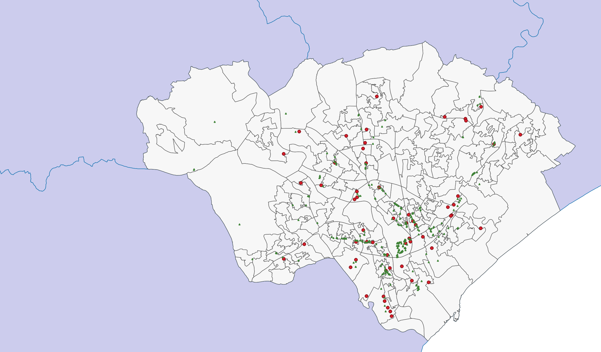
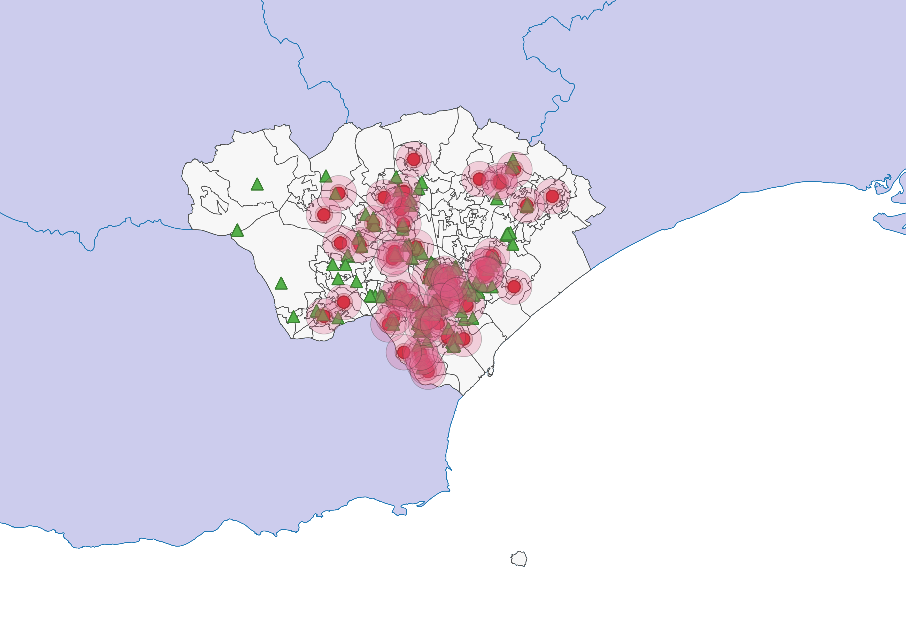
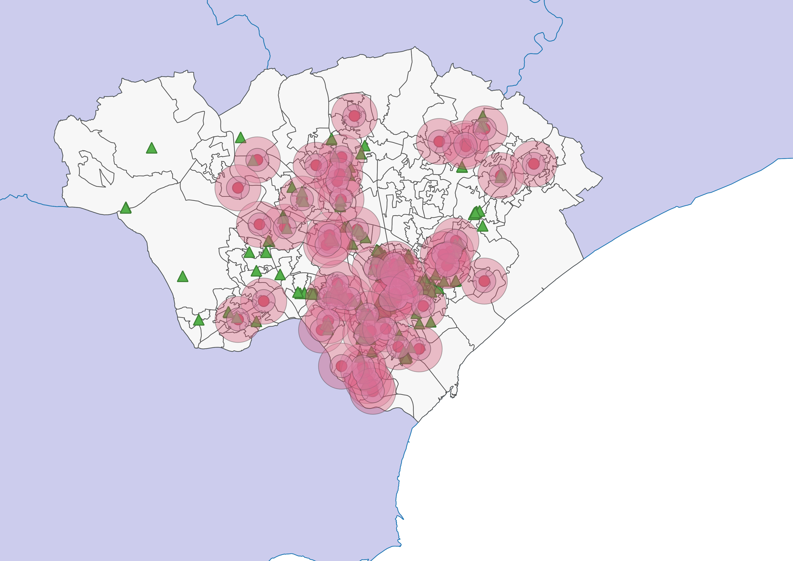
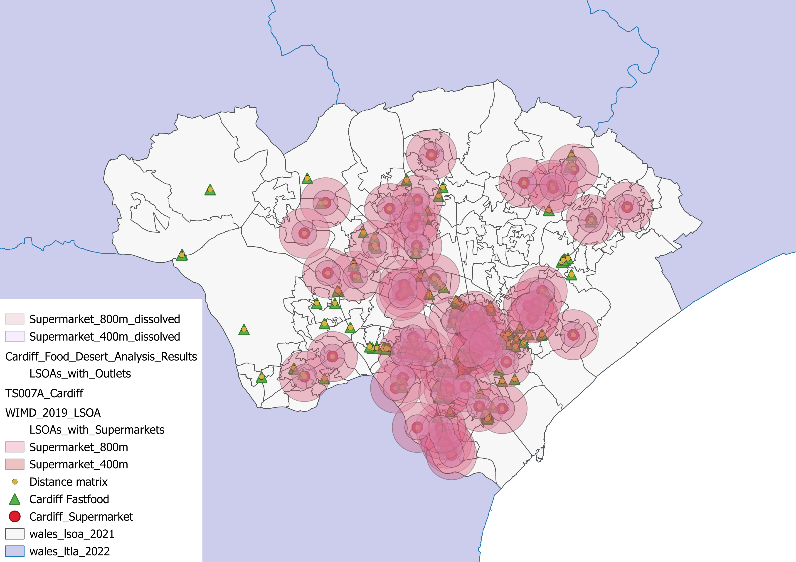
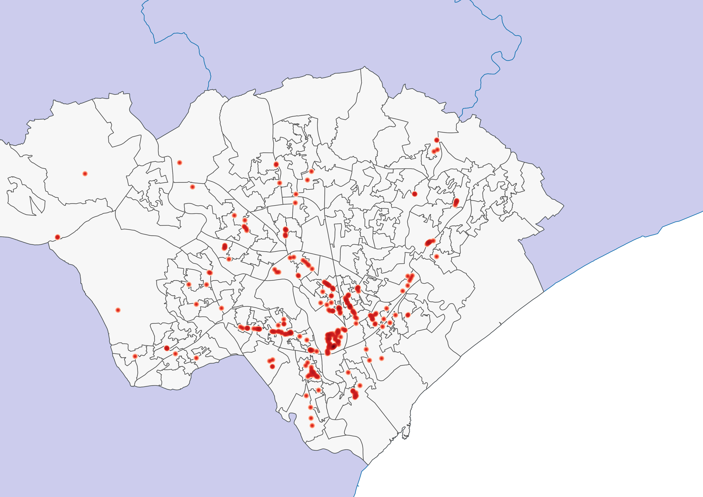

# 🗺️ Cardiff Food Desert Spatial Analysis

A Geographic Information Systems (GIS) research project analyzing spatial access to supermarkets and fast-food outlets in Cardiff to identify potential "food deserts."

## 📖 Overview
A "food desert" is an urban area in which it is difficult to buy affordable or good-quality fresh food. This repository contains spatial analysis data and QGIS projects focused on mapping and evaluating food environments in Cardiff, Wales. The goal is to highlight vulnerable zones that lack accessible supermarkets but possess a disproportionately high density of fast-food outlets, contributing to public health disparities.

## 🎯 Objectives
- **Spatial Mapping:** accurately map the locations of all major supermarkets and fast-food chains within the Cardiff municipal area.
- **Proximity Analysis:** Create multi-ring distance buffers to calculate walking and driving distances for residents.
- **Density Mapping:** Generate heatmaps of fast-food density.
- **Identification:** Cross-reference supermarket scarcity with fast-food abundance to identify specific food desert zones.

## 🛠️ Technology Stack
- **GIS Software:** QGIS 3.x
- **Data Formats:** GeoJSON, CSV, QGZ (QGIS Project), QMD (Quarto Markdown)
- **Coordinate Reference System (CRS):** British National Grid (EPSG:27700)

## 📂 Project Structure
```text
cardiff-food-deserts-gis/
├── data/
│   ├── raw/                  # Raw spatial data (GeoJSON)
│   └── processed/            # Processed distance matrices (CSV, TXT)
├── qgis_projects/            # QGIS project files (.qgz) and notebooks (.qmd)
└── results/maps/             # Generated visual outputs (PNG)
```

## 📈 Methodology
1. **Data Acquisition:** Acquired spatial point data for supermarkets and fast food locations.
2. **Buffering:** Applied 500m, 1000m, and 1500m buffers around supermarkets using QGIS processing tools to represent 5, 10, and 15-minute walking/driving catchments.
3. **Dissolving:** Dissolved overlapping buffers to create continuous service areas.
4. **Heatmap Generation:** Utilized Kernel Density Estimation (KDE) to visualize the concentration of fast-food outlets.
5. **Distance Matrix:** Calculated K-Nearest Neighbor (KNN) distances from residential centroids to the nearest food sources.

## 📊 Map Outputs & Screenshots
The visual outputs of the analysis clearly demonstrate the spatial disparity in food access across Cardiff.

### Distance Buffers & Density







## 👨‍💻 Author
**Agha Abdullah**
- GitHub: [@AGHAABDULLAH](https://github.com/AGHAABDULLAH)
## ⚖️ License
This project is licensed under the MIT License.
